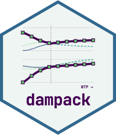
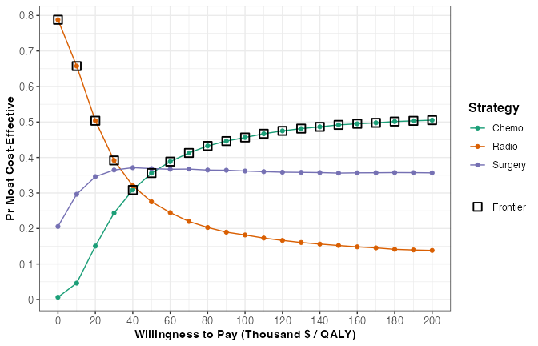
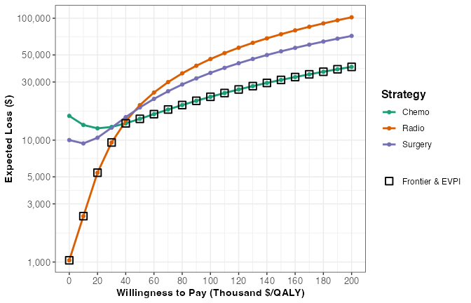

<!-- README.md is generated from README.Rmd. Please edit README.Rmd, then run devtools::build_readme(). -->

# dampack <a href="https://darth-git.github.io/dampack/"></a>

<!-- badges: start -->

[](https://CRAN.R-project.org/package=dampack)
[](https://github.com/DARTH-git/dampack/actions/workflows/check-standard.yaml)
[](https://app.codecov.io/gh/DARTH-git/dampack?branch=main)
<!-- badges: end -->

The Decision Analytic Modeling Package (dampack) is a suite of functions
for analyzing and visualizing the health economic outputs of
mathematical models.

## Why dampack

Decision-analytic models, such as decision trees, Markov cohort models,
microsimulations and discrete-event simulations, estimate the costs and
health outcomes of a set of strategies. Turning those outputs into the
results that cost-effectiveness studies and health technology
assessments report takes the same analyses every time: finding the
efficient frontier, computing incremental cost-effectiveness ratios
(ICERs), summarizing the probabilistic sensitivity analysis (PSA), and
estimating the value of collecting more information.

dampack does these analyses in R for any model. It only needs the
model’s outputs, so it works the same whether the model was written in R
or elsewhere. It is developed by the [DARTH
workgroup](https://www.darthworkgroup.com/), alongside the DARTH coding
framework for decision models ([Alarid-Escudero et al.,
2019](https://doi.org/10.1007/s40273-019-00837-x)), for health decision
scientists, health economists, and students.

## What it does

- **Cost-effectiveness analysis.** `calculate_icers()` identifies
  dominated and extendedly dominated strategies and computes ICERs along
  the efficient frontier; `plot()` draws the frontier.
- **Probabilistic sensitivity analysis.** `make_psa_obj()` stores the
  PSA output of any model. Its `plot()` and `summary()` methods show the
  cost-effectiveness plane, `ceac()` computes cost-effectiveness
  acceptability curves (CEACs) together with the acceptability frontier
  (CEAF), and `calc_exp_loss()` computes expected loss curves (ELCs),
  which show in one figure the expected foregone benefit of each
  strategy, the optimal strategy, and the expected value of perfect
  information ([Alarid-Escudero et al.,
  2019](https://doi.org/10.1016/j.jval.2019.02.008)).
- **Value of information.** `calc_evpi()` computes the expected value of
  perfect information (EVPI). `calc_evppi()` estimates the expected
  value of partial perfect information (EVPPI) with regression
  metamodels of the PSA ([Strong et al.,
  2014](https://doi.org/10.1177/0272989X13505910); [Jalal and
  Alarid-Escudero, 2018](https://doi.org/10.1177/0272989X17715627)), and
  `calc_evsi()` estimates the expected value of sample information
  (EVSI) of a future study with the Gaussian approximation approach
  ([Jalal and Alarid-Escudero,
  2018](https://doi.org/10.1177/0272989X17715627)). Both work from the
  PSA sample you already have, so no further model runs are needed.
- **Deterministic sensitivity analysis.** One-way and two-way analyses
  come either from the PSA, through metamodels (`owsa()`, `twsa()`), or
  from running your model directly (`run_owsa_det()`, `run_twsa_det()`),
  with tornado diagrams and optimal-strategy plots.
- **PSA inputs.** `gen_psa_samp()` draws parameter samples from common
  distributions, helpers such as `beta_params()` and `gamma_params()`
  convert means and standard deviations into distribution parameters,
  and `run_psa()` runs your model over the samples.

## Installation

Install the released version from CRAN:

``` r
install.packages("dampack")
```

Or the development version from GitHub:

``` r
# install.packages("remotes")
remotes::install_github("DARTH-git/dampack")
```

Installing from GitHub on macOS with a non-US locale may fail with
`Error: (converted from warning) Setting LC_CTYPE failed, using "C"`.
Running `defaults write org.R-project.R force.LANG en_US.UTF-8` in the
terminal fixes it.

## Example

`cancer_psa_data` holds the PSA output of an illustrative model that
compares three cancer treatments over 10,000 samples.

``` r
library(dampack)
data("cancer_psa_data")
l_psa <- make_psa_obj(cost = cancer_psa_data$cost,
                      effectiveness = cancer_psa_data$effectiveness,
                      parameters = cancer_psa_data$parameters,
                      strategies = cancer_psa_data$strategies)

# ICERs from the mean costs and QALYs of each strategy
calculate_icers_psa(l_psa)
#>   Strategy Costs ($) QALYs Incremental Costs ($) Incremental QALYs
#> 1    Radio    16,129 10.68                     -                 -
#> 2    Chemo    30,901 11.07                14,772              0.38
#> 3  Surgery    25,110 10.88                     -                 -
#>   ICER ($/QALY) Status
#> 1             -     ND
#> 2        38,492     ND
#> 3             -     ED
```

How likely is each strategy to be cost-effective across
willingness-to-pay thresholds? The acceptability frontier (squares)
marks the strategy with the highest expected net benefit at each
threshold.

``` r
v_wtp <- seq(0, 200000, by = 10000)
df_ceac <- ceac(l_psa, wtp = v_wtp)
plot(df_ceac)
```



The strategy most likely to be cost-effective is not always the optimal
one. At a willingness to pay of \$50,000 per QALY, Surgery has the
highest probability of being cost-effective (0.369), but Chemo has the
highest expected net benefit (probability 0.356), so Chemo is the
strategy on the frontier. This is why a CEAC should always be shown with
its frontier.

### Expected loss curves

Expected loss curves go one step further. For each strategy, they show
the benefit expected to be lost by choosing it instead of the strategy
that would turn out best, so they combine how likely a strategy is to be
the wrong choice with how much is lost when it is. In a single figure,
the strategy with the lowest expected loss is the optimal one, the
curves show where the optimal strategy switches across thresholds, and
the expected loss of the optimal strategy equals the expected value of
perfect information (EVPI). Alarid-Escudero et
al. ([2019](https://doi.org/10.1016/j.jval.2019.02.008)) describe these
advantages of ELCs over CEACs and the CEAF, and recommend reporting them
alongside CEACs, the CEAF and the EVPI.

``` r
df_elc <- calc_exp_loss(l_psa, wtp = v_wtp)
plot(df_elc, n_x_ticks = 10)
```



At \$50,000 per QALY, Chemo has the lowest expected loss, \$14,954 per
patient, which is also the EVPI at that threshold.

### Value of research: EVPPI and EVSI from one PSA

The EVPI is the most a decision maker should pay to remove all
uncertainty. To decide which research is worth doing, it helps to know
how much of that value comes from a few parameters, the EVPPI, and how
much a study of a given size would capture, the EVSI. Both usually need
nested simulations: running the model again for every possible study
result.

dampack avoids them. `calc_evppi()` fits a regression metamodel of the
net benefit on the parameters of interest across the PSA samples.
`calc_evsi()` uses the Gaussian approximation approach of Jalal and
Alarid-Escudero ([2018](https://doi.org/10.1177/0272989X17715627)). A
regression metamodel relates the net benefit to the parameters, and a
Gaussian approximation of the preposterior distribution tells how much a
study of `n` patients would narrow the uncertainty around them. It needs
only the PSA sample, and it works for correlated parameters,
non-Gaussian distributions, and several parameters informed by one
study.

Here the parameters of interest are the probabilities of treatment
failure with chemotherapy and with surgery, each estimated from an
earlier study of `n0 = 50` patients:

``` r
v_params <- c("pFailChemo", "pFailSurg")
calc_evpi(l_psa, wtp = 100000)
#>     WTP     EVPI
#> 1 1e+05 22683.95
l_evppi <- calc_evppi(l_psa, wtp = 100000, params = v_params,
                      outcome = "nmb", k = 3, progress = FALSE)
l_evppi$df_evppi
#>     WTP    EVPPI
#> 1 1e+05 8213.325
l_evsi <- calc_evsi(l_psa, wtp = 100000, params = v_params,
                    outcome = "nmb", k = 3, n0 = 50,
                    n = c(10, 50, 100, 500, 1000), progress = FALSE)
l_evsi$df_evsi
#>     WTP    n     EVSI
#> 1 1e+05   10 1331.363
#> 2 1e+05   50 4492.632
#> 3 1e+05  100 5837.748
#> 4 1e+05  500 7599.690
#> 5 1e+05 1000 7894.617
```

At \$100,000 per QALY, removing all uncertainty is worth \$22,684 per
patient, and 36% of that comes from the two failure probabilities. A new
study of 10 patients would capture \$1,331 per patient, and one of 1,000
patients would capture \$7,895, close to the EVPPI. Scaled to the
population affected by the decision and compared with the cost of each
study design, these values show whether a study is worth running, and
how large it should be.

## Learn more

The [package website](https://darth-git.github.io/dampack/) has the full
[function reference](https://darth-git.github.io/dampack/reference/) and
these articles, best read in this order:

1.  [Basic Cost Effectiveness
    Analysis](https://darth-git.github.io/dampack/articles/basic_cea.html)
2.  [Probabilistic Sensitivity
    Analysis](https://darth-git.github.io/dampack/articles/psa_analysis.html)
3.  [Value of Information
    Analysis](https://darth-git.github.io/dampack/articles/voi.html)
4.  [Probabilistic Sensitivity Analysis:
    Generation](https://darth-git.github.io/dampack/articles/psa_generation.html)
5.  [Deterministic Sensitivity Analysis:
    Generation](https://darth-git.github.io/dampack/articles/dsa_generation.html)

The same articles are installed with the package: see
`vignette(package = "dampack")`. What changed in each release is in the
[news](https://darth-git.github.io/dampack/news/).

## Citation

Run `citation("dampack")` for how to cite the package.

The expected loss curves in dampack, and why they complement CEACs and
the CEAF, are described in:

> Alarid-Escudero F, Enns EA, Kuntz KM, Michaud TL, Jalal H. “Time
> Traveling Is Just Too Dangerous” but Some Methods Are Worth
> Revisiting: The Advantages of Expected Loss Curves Over
> Cost-Effectiveness Acceptability Curves and Frontier. *Value in
> Health*. 2019;22(5):611-618.
> [doi:10.1016/j.jval.2019.02.008](https://doi.org/10.1016/j.jval.2019.02.008)

The Gaussian approximation approach that `calc_evsi()` uses to compute
the EVSI from a single PSA sample is described in:

> Jalal H, Alarid-Escudero F. A Gaussian Approximation Approach for
> Value of Information Analysis. *Medical Decision Making*.
> 2018;38(2):174-188.
> [doi:10.1177/0272989X17715627](https://doi.org/10.1177/0272989X17715627)

## Getting help and contributing

Please report bugs and suggest features in the [issue
tracker](https://github.com/DARTH-git/dampack/issues). To contribute
code, see the [contributing
guide](https://github.com/DARTH-git/dampack/blob/main/.github/CONTRIBUTING.md).
Everyone taking part in the project agrees to follow its [code of
conduct](https://github.com/DARTH-git/dampack/blob/main/CODE_OF_CONDUCT.md).

## Funding

This package was developed with funding from the National Institute of
Allergy and Infectious Diseases of the National Institutes of Health
under award no. R01AI138783. The content of this package is solely the
responsibility of the authors and does not necessarily represent the
official views of the National Institutes of Health.

## The DARTH team

dampack is developed by members of the [DARTH
workgroup](https://www.darthworkgroup.com/), a group of researchers
developing open-source tools for decision analysis in health.

**Package authors:** Fernando Alarid-Escudero (maintainer), Greg
Knowlton, Caleb W. Easterly, Matthew B. Kaufmann, and Eva Enns, with
contributions from David Garibay and Mark Clements.

**DARTH workgroup members:**

- Fernando Alarid-Escudero ([@feralaes](https://github.com/feralaes))
- Eva Enns ([@evaenns](https://github.com/evaenns))
- David U. Garibay-Treviño ([@du-gartre](https://github.com/du-gartre))
- Hawre Jalal ([@hjalal](https://github.com/hjalal))
- Matthew B. Kaufmann ([@mbkauf](https://github.com/mbkauf))
- Gregory Knowlton ([@gknowlt](https://github.com/gknowlt))
- Eline Krijkamp ([@krijkamp](https://github.com/krijkamp))
- Alexandra Moskalewicz
  ([@amoskalewicz](https://github.com/amoskalewicz))
- Petros Pechlivanoglou ([@ppehli](https://github.com/ppehli))
- Jorge Roa ([@jurjoroa](https://github.com/jurjoroa))
- Mathyn Vervaart ([@matverv](https://github.com/matverv))
- Ervin Wu ([@ervinro](https://github.com/ervinro))
- Yansi Wu ([@yansi5](https://github.com/yansi5))

**Other code contributors:** Szu-Yu Zoe Kao
([@syzoekao](https://github.com/syzoekao)) and Michael Fairley
([@mfairley](https://github.com/mfairley)).
